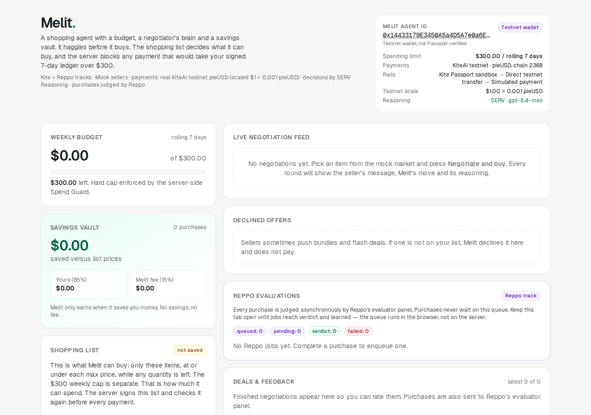

# Melit — it haggles, then the server decides whether it may pay

[](https://github.com/Agozie180/Melit/actions/workflows/test.yml)
[](https://github.com/Agozie180/Melit/blob/main/README.md#measured)
[](https://melit.vercel.app)
[](https://testnet.kitescan.ai/address/0x14433179E3450A5a4D5A7e0a6E81627e4e6421a8)
[](https://testnet.kitescan.ai/address/0x38129cf4CE5E183eFF248F42A7D345Bb1B47621A)
[](https://github.com/Agozie180/Melit/blob/main/package.json)
[](https://www.openserv.ai/hackathon-2)

**SERV Hackathon Edition 02.** Main track: **Kite**. Secondary: **Reppo**. Judged on creativity, user readiness, and revenue potential. Prize details stay on the [event page](https://www.openserv.ai/hackathon-2); there is no award yet, so the program badge says "not announced."

The coverage badge is the line rate from `npm run test:coverage` on 15 Nov 2026: 46.32% of lines in `lib/` and `app/` (763/1647). That number includes the UI, which these tests do not render. `lib/guard/spend-guard.ts` is 100% lines. Melit is not an npm package. The blue badges are the public testnet wallet and the pieUSD token the app pays with. They are not a Sourcify-verified contract written by this repo.

| | |
| --- | --- |
| Live app | https://melit.vercel.app |
| Production check | Vercel production `dpl_DDf3wQgBvDGqPc6B7iozisRAMuPk` is READY for `d5fc3eb`. `GET https://melit.vercel.app/api/agent` reports `passport.runtimeReady: true` and `kite-passport-sandbox` in the rail list. |
| Demo | [demo.md](./demo.md) is the 90-second script. [demo.mp4](./demo.mp4) is an older 1:55 cut and does not follow that script. |
| Write-up | [SUBMISSION.md](./SUBMISSION.md) |
| Judging brief | [JUDGING.md](./JUDGING.md) |
| Blueprint | [ARCHITECTURE.md](./ARCHITECTURE.md) |
| Self-audit | [AUDIT.md](./AUDIT.md) |
| KiteScan wallet | https://testnet.kitescan.ai/address/0x14433179E3450A5a4D5A7e0a6E81627e4e6421a8 |
| pieUSD contract | https://testnet.kitescan.ai/address/0x38129cf4CE5E183eFF248F42A7D345Bb1B47621A |
| Reproduce the checks | `npm test` and `npm run test:coverage` |

> **The model may suggest a price. The server will not pay unless the item is on your signed list, quantity is left, the price is within that item's max, and the last 7 days plus this price is at most $300.**

People pay the sticker price because haggling is awkward and the money leaks out a little at a time. Melit negotiates with four mock sellers, shows the reasoning, and runs that check in server code before any payment. What it saved versus list price goes in a vault: 85% shown as yours, 15% as Melit's fee. That split is arithmetic. It is not a charge to a card.



## What we built

1. **A signed shopping list** of `{ name, maxPrice, quantity }`. That is what Melit can buy.
2. **A $300 rolling 7-day cap.** That is how much it can spend. Both checks are in `authorizePurchase`, and a blocked result never calls a payment rail.
3. **A negotiation.** Each round asks SERV Reasoning first. If the call fails or the JSON does not validate, the round is labelled **Fallback heuristic**.
4. **An identity card** that says **Kite Passport sandbox** only when live `kpass agent status` succeeds in that request. Otherwise it shows the KiteAI testnet wallet (labelled not Passport-verified) or a simulated id. On https://melit.vercel.app the card may still read testnet wallet while `/api/agent` reports `passport.runtimeReady: true`.
5. **A payment rail** that sends pieUSD on KiteAI testnet (chain 2368) when a throwaway key is set and the wallet can pay. A dry wallet, or no key, produces a receipt labelled Simulated or Recorded. Production runs Rail 1 when `KPASS_RUNTIME_BUNDLE_B64`, `KPASS_SESSION_ID`, and related env are set (see `.env.example`); otherwise only Rail 2 and labelled fallbacks run.
6. **A learning loop.** Owner notes and seller reviews move a capped strategy. Reppo is called only when `REPPO_API_KEY` is set, and a score appears only after Reppo returns one.

## How a purchase runs

```text
save list → server HMAC
ask for an item
  → each round: SERV Reasoning (or a labelled fallback) → code clamps the move
  → off-list seller push: log "declined: not on your list" (no payment)
deal price → authorizePurchase(list, ledger, price)
  → allowed: payment rail → signed ledger row → vault
  → blocked: stop. The rail is not called.
```

The invariants and the cut line are in [ARCHITECTURE.md](./ARCHITECTURE.md). The file map is below, under [Architecture](#architecture).

## What's used, and what's deliberately not

| Surface | Used? | Evidence, or why not |
| --- | --- | --- |
| SERV Reasoning | Yes, when `OPENSERV_API_KEY` is set | `POST https://inference-api.openserv.ai/v1/chat/completions` in `lib/adapters/reasoning.ts`. Prompt `melit-negotiator-v3`. |
| Kite track: spending limit you control | Yes, in server code | `lib/guard/spend-guard.ts` and `lib/server/shopping-list.ts`. The limit is per browser, not a Passport session, on the public deploy. |
| Kite Passport | Local `kpass` or Vercel with runtime bundle | Without `KPASS_RUNTIME_BUNDLE_B64`, the public card stays testnet wallet. |
| pieUSD on KiteAI testnet (chain 2368) | When `AGENT_PRIVATE_KEY` is set and the wallet can pay | Recorded sample hashes live in `data/recorded-receipts.json`. A failed or unconfigured rail is labelled. |
| Reppo Evaluation API | When `REPPO_API_KEY` is set | `lib/adapters/reppo.ts`. The UI does not invent a score. |
| Dolphin | No | Melit does not call Dolphin models. |
| Real shops | No | Four labelled mock sellers in `lib/market/catalog.ts`. Their hidden floor prices stay on the server. |

## The thesis, enforced

| The model may | The code will not |
| --- | --- |
| Offer, accept, or walk, and explain why | Pay for an item that is not on the signed list |
| Name a price | Pay above that row's max, or after its quantity is used up |
| Tell you to take a bundle | Pay for an off-list push. The log is `declined: not on your list` until you press **Approve and save** |
| Ignore a seller who says "ignore your list" | Skip `authorizePurchase`. A blocked result returns before `deps.pay` |

## Measured

Numbers below are what the tests assert. Re-run the command rather than trusting this paragraph if the suite has moved.

| Claim | What the test asserts | Reproduce |
| --- | --- | --- |
| $300.00 is allowed and $300.01 is blocked | `allowed === true` on the cap, then a reason matching `$0.01 over` | `npm test -- tests/spend-guard.test.ts` |
| Off-list, over max, and used-up quantity are blocked | reasons match `not on your shopping list`, `above the $80.00 maximum`, `none are left` | `npm test -- tests/shopping-list.test.ts` |
| A renamed ledger row cannot restore quantity | `signature mismatch`, purchase not allowed | same file, "item name was rewritten" |
| A blocked purchase does not call the rail | the pay mock is not called | `npm test -- tests/payments.test.ts` |
| The hidden floor is not in the SERV prompt | the user message does not match `/floor/i` | `npm test -- tests/negotiator.test.ts` |
| Line coverage of `lib/` and `app/` | 46.32% lines (763/1647). Statements 43.95%. Branches 36.67%. Functions 39.69%. `spend-guard.ts` is 100% lines. UI files are 0% | `npm run test:coverage` |

On 15 Nov 2026, `npm test` reported 98 passing tests. The coverage row is from the same day's `npm run test:coverage`.

## Try it in 30 seconds

No API key is required. Without one, the banner says so and every round is labelled **Fallback heuristic**. Payments are then labelled Simulated.

1. Open the app and do not save a list yet.
2. Press **Wireless Earbuds**, then **Negotiate and buy**. Melit declines. No payment runs.
3. Add Wireless Earbuds, max `$120`, quantity `1`, and press **Save list**. The badge says **signed** and the row says **waiting**.
4. Negotiate again. The Bluetooth Speaker flash deal logs `declined: not on your list`. **Add to list?** does nothing until **Approve and save**.
5. Press **Try to overspend**. If money is left and the chair is not on the list, the block names the list. To show the weekly cap, add Espresso Machine Pro with max `$349`, save, and press **Try to overspend** again.

## Limitations, stated plainly

- The list and the ledger live in this browser. **Reset demo**, or clearing storage, starts the week over and restores quantities. On the public demo every visitor is paid from one shared testnet wallet, so both controls are per browser.
- `POST /api/shopping-list` signs any valid rows. The signature proves this server saw them. It does not prove which person approved them.
- Rate limits live in each serverless instance. A burst can land on more than one instance. See [Abuse limits](#how-the-spend-guard-works).
- Passport on Vercel needs `npm run kite:export-runtime` pasted as `KPASS_RUNTIME_BUNDLE_B64` plus `KPASS_SESSION_ID` and a public `SELLER_BASE_URL`. Without them Rail 1 is off. With them, Rail 1 may run even if the agent card still shows a testnet wallet until `kpass agent status` confirms in serverless.
- The 15% line in the vault is not money collected from anyone.

## Non-goals

Not a store, not a card product, not a Dolphin model, and not a merchant allowlisted for Passport checkout yet. The UI never claims Passport verification that `kpass` did not confirm. Seller floors stay server-side. The model is not the spend authority.

## The problem

Most people pay the list price. They don't negotiate because it's awkward, and they don't save because the money leaks out a little at a time. Shopping agents could fix both, but handing an AI your card is scary. You need an agent that bargains hard, explains every decision, and has a hard budget check in code before every payment.

## How SERV Reasoning is used

SERV Reasoning is OpenServ's reasoning layer. It's wire-compatible with the OpenAI Chat Completions API, so Melit calls it with plain `fetch` (`lib/adapters/reasoning.ts`):

```
POST https://inference-api.openserv.ai/v1/chat/completions
Authorization: Bearer $OPENSERV_API_KEY
{
  "model": "gpt-5.4-mini",
  "reasoning_effort": "low",
  "messages": [{ "role": "system", ... }, { "role": "user", ... }],
  "response_format": { "type": "json_schema", "json_schema": { "strict": true, ... } }
}
```

- **Each negotiation round asks SERV first** (prompt `melit-negotiator-v3`). The model receives the item, list price, market reference price, the current ask, the negotiation history, the remaining weekly budget, your max price, your priority ("save more" or "buy fast"), and the shopping list with each row's max price and quantity remaining. It also sees seller bundles and flash deals, and is told to refuse any that are not on the list. It never receives the seller's hidden floor price. A round that does not get a valid SERV reply is the labelled fallback in the next bullet, not a silent SERV call.
- It must return strict JSON: `{ "action": "offer" | "accept" | "walk", "offerPrice": number, "reasoning": string[], "confidence": number }`.
- Output is validated with **zod**. If the call fails, times out, refuses, or returns JSON that doesn't validate, a simple heuristic takes that round and the UI labels it **Fallback heuristic** together with the reason.
- Following SERV's "Day One" guidance, the model does the judgment and code does the arithmetic and hard limits. Ceilings and gaps are pre-computed in the prompt, and after the model decides, code guardrails clamp offers to the shopping-list maximum, your max price and the remaining budget, and walk away if the item is off the list or the quantity is used up. Any adjustment is shown in the reasoning trail. The payment itself is checked again by the Spend Guard, which does not trust the model's answer.

## Architecture

```
app/
  page.tsx                  Dashboard (client): agent card, budget gauge, vault, shopping list, form, feed, ledger
  api/agent/route.ts        GET  identity, reasoning status, public catalog
  api/negotiate/route.ts    POST stream (NDJSON) of negotiation rounds, deal, guard result, receipt
  api/overspend/route.ts    POST demo: try a purchase the guard should block (list, or the weekly cap)
  api/shopping-list/route.ts
                            POST the owner's list; the response is the signed allowlist
  api/sellers/[sellerId]/checkout/route.ts
                            Mock seller x402 checkout (@x402/next, exact scheme, pieUSD on eip155:2368)
lib/
  market/catalog.ts         4 mock sellers, 11 items, hidden floor prices (server-only)
  market/seller.ts          Deterministic seller rules (no LLM): accept at floor, shrinking counters, walk after 4 rounds
  negotiation/negotiator.ts SERV prompt + JSON schema, zod validation, fallback heuristic, guardrails
  negotiation/run.ts        Negotiate -> deal check -> Spend Guard (list + cap) -> payment -> signed ledger entry
  guard/spend-guard.ts      The pure Spend Guard: shopping list, then the $300 cap
  shopping/list.ts          Allowlist rows, quantity remaining, declined-offer log line
  server/shopping-list.ts   List signing (HMAC) + authorizePurchase()
  server/ledger.ts          Ledger verification (HMAC) + authorizeSpend()
  market/offers.ts          Occasional mock-seller bundles and flash deals
  adapters/reasoning.ts     ReasoningAdapter  -> SERV Reasoning
  adapters/identity.ts      Identity: Passport sandbox (confirmed via kpass) > testnet wallet > simulated
  kite/config.ts            KiteAI testnet constants (chain 2368, pieUSD, KiteScan) and the testnet scale
  payments/router.ts        Tries rails in order with explicit no-fallback cases
  payments/kpass-rail.ts    Rail 1: `kpass session execute` as a child process (argv array, no shell)
  payments/testnet-rail.ts  Rail 2: viem ERC-20 pieUSD transfer from AGENT_PRIVATE_KEY
  payments/offline-rails.ts Recorded-receipt replay and simulated receipts (both move no money)
  payments/order-token.ts   Signed orders: the seller checkout only charges Guard-approved orders
  learning/profile.ts       Strategy profile + applyBoundedUpdate (hard ranges, per-source step caps)
  learning/feedback.ts      SERV turns owner notes / Reppo verdicts into strict-JSON updates (labelled fallback)
  learning/reputation.ts    Seller reputation -> willingness and floor premium
  learning/reppo-input.ts   Synthetic, scrubbed transcript submitted to Reppo
  learning/reppo-queue.ts   One-at-a-time Reppo job queue (pure reducer)
  learning/metrics.ts       Before/after-feedback metrics
  market/reviews.ts         Deterministic, signed seller reviews (server-only, uses the hidden floor)
  adapters/reppo.ts         Reppo Eval Router client (POST/GET /api/v1/agents/evals)
app/api/feedback/route.ts   POST owner feedback or "learn from this Reppo verdict"
app/api/reppo/route.ts      POST submit a signed purchase summary to Reppo; GET /api/reppo/[id] polls it
scripts/kite-setup.mjs      Guided `kpass` sandbox setup (login check, faucet, agent, 30-day session)
tests/                      vitest: spend guard, ledger tampering, sellers, negotiator, payment rails
```

Reasoning, identity and payments each sit behind an interface, so they can be swapped without touching the negotiation or guard logic.

**No database.** The ledger and the shopping list live in the browser's localStorage and are sent with every request. The server never trusts a client total, a client "remaining quantity", or an `allowed: true` flag. It verifies the signatures, then recomputes the weekly sum and the quantity left from the entries themselves.

## How the Spend Guard works

`lib/guard/spend-guard.ts` runs before **every** payment, including the overspend demo, which deliberately bypasses Melit's own negotiation guardrails to show that the last line of defense still holds. A purchase is allowed only when every rule below passes. The first failure is the reason shown in the UI.

**What it can buy (the shopping list).** You edit the list, then save it. `POST /api/shopping-list` checks the rows and HMAC-signs them. Each row is `{ name, maxPrice, quantity }` with `maxPrice` in integer cents.

- The item's name has to match a row (case and extra punctuation ignored).
- Quantity remaining is `quantity` minus matching purchases in the signed ledger. The 7-day window does not refill it. Raise the quantity and save again if you want another.
- The price has to be at or under that row's `maxPrice`.
- Mock sellers sometimes push a bundle or a flash deal (Bundle Barn always bundles a sibling item; the flexible seller and the bluffer attach a flash deal; the firm seller only upsells the skillet when you are buying the knife). If that item is not on the list, Melit declines it in code, logs `declined: not on your list` with the reasoning, and shows **Add to list?** The button does nothing until you approve the name, max price and quantity. The model is told about the push and cannot approve the payment.

**How much it can spend (the weekly cap).**

- Rule: `sum(purchases in the last 7 days) + this purchase <= $300.00`, or the payment is blocked with a human-readable reason.
- All money is integer cents, so "exactly $300.00" passes and "$300.01" is blocked.
- Rolling window: an entry counts while it is less than 7 days old.
- Future-dated entries still count, and negative or garbage amounts can only make the guard stricter.
- Before the guard runs, `lib/server/ledger.ts` verifies the ledger and `lib/server/shopping-list.ts` verifies the list. Every ledger entry is HMAC-signed by the server when a purchase is approved. The signature covers the item name and the seller name as well as the amount, the time, and the receipt, so renaming a purchase cannot restore quantity. The list is HMAC-signed when you save it. If a client lowers an amount, back-dates a purchase, renames an item, raises a max price, adds an item, or forges a signature, spending is frozen. Entries signed by an older build, whose signature did not cover the item name, no longer verify. Reset demo once if a browser already holds a ledger from that build. Extra fields like `weeklySpent: 0`, `remaining: 9` or `allowed: true` are stripped and ignored.

Tests (`npm test`) cover exactly at the cap, one cent over, the window rolling forward, future-dated entries, invalid amounts, a client-supplied fake total, an edited amount, a back-dated entry, a forged signature and a malformed ledger. They also cover an off-list purchase, a price over the list max, a used-up quantity, a listed item that still fails the weekly cap, and a tampered list (edited max, added item, or a `remaining` field) that cannot get past the server.

**Known limitation:** without server-side storage, a user can delete their own localStorage ledger and start a fresh week, which also restores shopping-list quantities. The Reppo job track is also per-browser (localStorage), not server-backed. The Reset demo button does exactly this on purpose. It does not clear the shopping list. Saving a new list is the owner's approval, so anyone who can use the demo as you can also save a wider list. On the public demo, every visitor's purchases are paid from one shared testnet agent wallet, so both controls apply per browser, not per wallet. A production version would persist the list and the ledger server-side, or enforce the limit at the wallet level with a Kite Passport spending session.

**Abuse limits on the public demo.** `/api/negotiate` (up to 4 SERV calls and one testnet payment), `/api/feedback` (one SERV call), `/api/overspend`, `/api/shopping-list`, and `/api/reppo` (submit and poll) use `lib/server/rate-limit.ts`. `POST /api/reppo` also dedupes each deal and enforces a 20-second gap per IP before a new submission. `GET /api/reppo/[id]` rejects malformed ids. These counters live in each serverless instance, and Vercel spreads one client's requests over several instances (visible in the `X-RateLimit-Remaining` header on the shared limiter), so on the deployment they bound abuse per instance rather than exactly. A Vercel Firewall rate-limit rule (12 POSTs per minute per IP to those routes) is also configured, but a 24-request burst test did not trigger it, so treat it as unverified. A shared counter (e.g. Upstash Redis) is the proper fix and is on the roadmap. The testnet wallet only holds faucet pieUSD, and each payment is capped by the x402 client's spend control.

## Payments on KiteAI testnet

Everything runs on **KiteAI testnet** (chain ID 2368, RPC `https://rpc-testnet.gokite.ai/`, explorer `https://testnet.kitescan.ai`) using free **pieUSD** test tokens. There is no mainnet configuration in the code. Amounts are scaled down so a faucet drip covers a whole week: by default $1.00 of price = 0.01 pieUSD, so the $300 weekly cap is 3 pieUSD on chain (`MELIT_TESTNET_SCALE`).

The order of checks for every purchase:

1. **Spend Guard first.** The signed shopping list and the $300 cap both have to approve the exact amount, or nothing else runs (`lib/negotiation/run.ts`).
2. **Rail 1: Kite Passport sandbox.** The server runs `kpass sandbox status`, and refuses to continue unless kpass confirms sandbox mode. It then runs `kpass session execute --method GET --url <mock seller checkout> --idempotency-key <order id>` as a child process with an explicit argument list (no shell). The mock seller's checkout is a real x402 endpoint built with `@x402/next`: it answers HTTP 402 with exact-scheme pieUSD requirements on `eip155:2368` and settles through the Pieverse facilitator. It only charges orders signed by Melit after Guard approval. The approved Passport session (3 pieUSD over **30 days** on the public hackathon deploy) is a **second** limit layer.
3. **Rail 2: direct testnet transfer.** If Rail 1 fails for any reason other than the two exceptions below (not logged in, not sandbox, `host_not_in_executable_catalog`, `sandbox_merchant_not_allowlisted`, unreachable seller, and so on), Melit pays the mock seller straight from `AGENT_PRIVATE_KEY`. It confirms the RPC reports chain 2368, then:
   - **Gasless pieUSD (default).** The agent signs an EIP-3009 `transferWithAuthorization` for pieUSD with viem (the x402 "exact" scheme, `@x402/evm`). The Pieverse x402 facilitator verifies it, submits it on KiteAI testnet and pays the KITE gas. The x402 client's own spend control refuses to sign anything above the weekly cap, which is a third limit layer.
   - **Plain ERC-20 transfer.** Used when the wallet doesn't hold enough pieUSD but has faucet test USDT and KITE for gas.

   Either way Melit waits for the on-chain receipt before recording the purchase. Once a transaction may have been submitted, it never falls back, to avoid paying twice.
4. **Optional labelled fallback.** With `MELIT_SIMULATED_FALLBACK=1`, if every real rail fails (for example, the public demo wallet ran dry), Melit issues a receipt labelled **Simulated payment** that says no money moved and lists why each real rail failed.

Two deliberate exceptions to "fall back for any reason":

- If the Passport session refuses the payment (`session_total_exceeded`, `payment_cap_exceeded` and similar), Melit does **not** fall back. Routing around the session cap would defeat the second limit layer.
- If the Passport outcome is unknown (exit code 7, `payment_outcome_pending`), Melit does **not** fall back either, because the first payment may still land and falling back could pay twice.

If every rail fails, the purchase fails, the feed shows each rail's error, and no ledger entry is written.

Each ledger entry stores the rail that paid, the tx hash and a KiteScan link, and all of these are covered by the server's HMAC signature.

**Kite Passport status (tested Nov 15, 2026):**
- **Production backend** (`passport.prod.gokite.ai`): in sandbox mode, `kpass agent register` aborts with `sandbox mode mismatch: server reported X-Kite-Mode="live"`, and the faucet is "disabled on production".
- **Staging backend** (`KPASS_BASE_URL=https://passport.staging.gokite.ai`): sandbox works end to end. Melit's agent is registered, its faucet funded the wallets with pieUSD on chain 2368, and a "Melit hackathon judge window" session (3 pieUSD, **30 days**) can be approved with a passkey (`npm run kite:setup` uses `--ttl 30d`).
- **What still blocks Rail 1:** `kpass session execute` against the mock seller returns `payment_target_forbidden … reason="sandbox_merchant_not_allowlisted"`. Kite only lets sessions pay allowlisted merchants, and listing a seller requires account KYC. So today every purchase genuinely tries Rail 1, records Kite's refusal in the receipt's attempt trail, and settles through Rail 2.
- Once the seller host is allowlisted, Rail 1 pays first with no code change.

**Why a public seller URL:** with `kpass session execute`, the Passport *backend* calls the seller URL and settles the payment, so the mock seller checkout must be reachable from the internet (`SELLER_BASE_URL`, for example your Vercel deploy). A `localhost` seller can't be paid through Rail 1, so those payments use Rail 2.

**Demo video vs deployed site:** kpass needs a local terminal and a passkey for first-time setup (`npm run kite:setup`). After export, Vercel can run the bundled CLI from `KPASS_RUNTIME_BUNDLE_B64` (configured on https://melit.vercel.app as of `d5fc3eb`). Without that secret a deploy uses Rail 2 only. The live demo makes **real KiteAI testnet payments** from a throwaway wallet funded with faucet pieUSD, at `MELIT_TESTNET_SCALE=0.001` (a $300 week = 0.3 pieUSD). `MELIT_SIMULATED_FALLBACK=1` covers the case where that wallet runs dry, and those receipts are labelled Simulated. With `MELIT_PAYMENT_MODE=recorded` the site instead replays real receipts from `data/recorded-receipts.json` (written locally with `MELIT_RECORD_RECEIPTS=1`), labelled **Recorded receipt (replay)** with "No new payment was made".

## Reppo track: Melit learns from feedback

Melit gets better at negotiating from three kinds of feedback. All of them flow into one **strategy profile** (`lib/learning/profile.ts`):

| Setting | Range | What it does |
| --- | --- | --- |
| `aggressiveness` | 0 to 1 (default 0.5) | How far below the market reference Melit opens and how slowly it concedes |
| `walkAwayThreshold` | 0.85 to 1.30 × market (default 1.05) | The most Melit will pay. Enforced as a **code guardrail**, not just a prompt hint |
| `priority` | `save` / `speed` | Standing preference; also pre-selects the request form |
| `notes` | at most 6, ≤ 140 chars each | Lessons in the owner's words |

The profile is stored in localStorage, sent with every request, clamped by the server with zod, and injected into **every SERV negotiation call** (prompt `melit-negotiator-v3`) together with Melit's seller reputation and the shopping list. The fallback heuristic uses it too. It is shown in the **Melit's strategy** card.

**Bounded updates.** Every change goes through `applyBoundedUpdate`. Whatever proposes a change (SERV, a rule or a Reppo verdict), one update can move aggressiveness by at most ±0.15 (owner), ±0.10 (Reppo) or ±0.05 (market), and the walk-away limit by ±0.05 / ±0.04 / ±0.02. It can add at most one note and remove at most one. Results are always clamped to the hard ranges. A 2,000-step fuzz test checks this, including NaN and infinite deltas.

### 1. Owner feedback
After each negotiation, the **Deals & feedback** card asks for 👍 or 👎 and an optional note. `POST /api/feedback` sends the signed deal summary, the note and the current profile to **SERV Reasoning** (prompt `melit-learner-v1`). SERV returns strict JSON `{aggressivenessDelta, walkAwayThresholdDelta, priority, addNote, removeNoteIndex, learned}`, which is validated with zod and then bounded. The `learned` sentence is shown as **What Melit learned**. If SERV fails, a keyword rule proposes the update instead and it is labelled **Fallback rule** with the reason.

### 2. Market feedback (seller reviews)
After every negotiation, the mock seller rates Melit from 1 to 5 using **deterministic rules** (`lib/market/reviews.ts`, no LLM). The rating depends on Melit's lowest offer relative to the seller's hidden floor (generous / firm / aggressive / insulting), how many rounds it took and how it ended. The floor is never revealed: the review only carries a coarse pressure label. Reviews are HMAC-signed, and the server ignores unsigned or edited ones.
- **Reputation changes seller behaviour.** An average rating of 5 keeps sellers at normal willingness. Each star lost makes them concede 10% less per round (down to 60%). At 2.5★ or lower, they also hold out 3–5% above their usual floor. Sellers with no reviews of their own use the market-wide average ("sellers talk").
- **Melit learns from it.** An insulting lowball or a rating of 2 or less lowers aggressiveness by 0.05; a seller accepting with no pressure raises it by 0.03. The **Market reputation** card shows this.

### 3. Reppo Evaluation API (async judge)
After each **purchase**, Melit submits the negotiation to the [Reppo Eval Router](https://eval.reppo.xyz/agents.md):

```
POST https://eval.reppo.xyz/api/v1/agents/evals      Authorization: Bearer $REPPO_API_KEY
{ "taskType": "action", "input": "<what the user asked for + every round's offer, reasoning and seller reply + outcome>" }
-> 201 { "id": "...", "status": "QUEUED" }
GET  https://eval.reppo.xyz/api/v1/agents/evals/{id}
-> { "status": "QUEUED|PROCESSING|COMPLETED|FAILED", "result": { "score", "route": "ship|review|block", "decision", "confidence", "reason", "rubric_scores", "consensus" }, "trace": {...} }
```

- **Synthetic data only.** The input is built from mock-seller names, catalogue prices and Melit's reasoning. It never includes keys, wallet addresses, tx hashes or personal data, and it is scrubbed afterwards for anything that looks like a 0x address, long hex, email, URL or token (`lib/learning/reppo-input.ts`, tested).
- **Never blocks.** Jobs go into a browser-side queue (`melit.reppo.v1`). A background hook submits one at a time and polls every 10 s, and shows each job as **queued**, **pending**, **verdict** (score, route, confidence, rubric, each evaluator model's score) or **failed**. Purchases never wait for it. Transient errors back off exponentially; 401/402/400 fail the job.
- **Strategy updates don't wait for Reppo.** Owner and market feedback apply immediately. When a verdict arrives, `POST /api/feedback {kind: "reppo", evalId}` makes the server **re-fetch the verdict from Reppo itself**, check that the evaluated text is exactly this deal's transcript, and ask SERV for a bounded update. The update is recorded as **Learned from Reppo verdict**.
- **Abuse limits.** Only server-signed summaries of real purchases less than an hour old are accepted. Each deal is submitted at most once, and there is a per-client gap between submissions. A completed text evaluation costs 440 Reppo credits.

A real verdict for one of Melit's negotiations (earbuds bought for $88.55 against a $129 list price) came back in about 70 s: score **97**, route `review`, decision `accept`, confidence medium, rubric scope 100 / safety 100 / correctness 100 / reversibility 81. The evaluators were gpt-4o (100), deepseek-chat (100) and glm-5-2 (96).

**Docs note:** the endpoints on docs.reppo.ai (`/agents/eval-requests/*`) are outdated and currently return 404. Melit uses the live API described at https://eval.reppo.xyz/agents.md, verified with real requests.

### Dashboard
**Is Melit getting better?** compares deals run with the default strategy (profile version 0) against deals run after feedback changed it at least once:
- average % saved versus list price, and price paid versus the market reference;
- deals closed % (guard blocks and payment errors excluded);
- owner approval % (👍 out of rated deals);
- the average Reppo score over verdicts that were actually returned.

It only uses negotiations you ran in this browser. Nothing is pre-filled or seeded, so a fresh browser shows empty metrics until you start using it.

## What's simulated vs real

| Part | Status |
| --- | --- |
| Learning loop (profile, owner feedback, bounded updates) | **Real.** SERV proposes updates; code bounds them. Fallback updates are labelled. |
| Seller reviews and reputation | **Deterministic rules** from the mock sellers, signed by the server. |
| Reppo verdicts | **Real Reppo Eval Router evaluations** when `REPPO_API_KEY` is set. Only verdicts Reppo actually returned are shown. |
| SERV Reasoning negotiation decisions | **Real** when `OPENSERV_API_KEY` is set. Rounds that use the fallback are labelled. |
| Spend Guard, shopping list and ledger signing | **Real**, enforced in server code, unit tested. The list is what it can buy; the $300 cap is how much it can spend. |
| Sellers and marketplace | **Mock sellers**: four labelled sellers with deterministic rules. Only their checkout endpoint is real x402. |
| Agent identity | **Kite Passport sandbox** only when live `kpass agent status` succeeds. Otherwise **testnet wallet** (real key, labelled not Passport-verified) or **Simulated**. |
| Payments, Rail 1 | **Real Kite Passport sandbox call** with an approved session on local and Vercel deploys when the runtime bundle is set. Kite currently refuses non-allowlisted merchants, and the receipt shows that refusal. |
| Payments, Rail 2 | **Real testnet payments.** Gasless pieUSD via the x402 facilitator, or an ERC-20 transfer. Live on https://melit.vercel.app with KiteScan links. |
| Recorded / simulated receipts | **No money moves.** Shown as "Recorded receipt (replay)" or "Simulated payment". |

The UI never shows a simulated or recorded payment as a new real payment, and never claims Passport verification that kpass didn't confirm.

## Revenue model

Melit keeps **15% of the money it saves you**; you keep **85%**. If Melit doesn't save you anything, it earns nothing. The Savings Vault shows the split live.

Why this works: the incentive is aligned (Melit only wins when you do), there's no subscription to justify, and the fee scales with purchase volume. Later options: merchant-side lead fees for sellers that accept agent negotiation, and a premium tier with higher caps and multi-seller comparison.

## Setup

```bash
git clone https://github.com/Agozie180/Melit melit && cd melit
npm install
cp .env.example .env.local     # set OPENSERV_API_KEY (from https://console.openserv.ai/)
npm run dev                    # http://localhost:3000
npm test                       # Spend Guard, shopping list, negotiation, payment-rail and learning-loop tests
```

Without a key the app still runs, but every round is labelled **Fallback heuristic** and a banner says SERV isn't configured. With no payment rail configured, payments are **simulated** and labelled that way.

### Testnet payments (local)

1. **Rail 2 (quickest).** Create a throwaway wallet that you'll only use on testnet and set `AGENT_PRIVATE_KEY` and `MOCK_SELLER_PAYTO` in `.env.local`. Fund it with pieUSD from the Kite Passport faucet (`npm run kite:setup -- --base-url https://passport.staging.gokite.ai --agent-wallet <address>`), which needs no gas thanks to the facilitator. Or claim KITE and test USDT at https://faucet.gokite.ai. Check funding with `npm run testnet:balance -- <address>`.
2. **Rail 1 (Kite Passport sandbox).** Install the CLI (`curl -fsSL https://cli.gokite.ai/install.sh | bash`) and sign in (`kpass login`, or `kpass login init --email` for an email code). Run `npm run kite:setup -- --base-url https://passport.staging.gokite.ai`, which switches on sandbox mode, requests faucet pieUSD, registers the agent and creates a **30-day** "Melit hackathon judge window" session (`--ttl 30d`). Approve the printed URL with your passkey. Then set `MELIT_KPASS=1`, `KPASS_BASE_URL`, `KPASS_SESSION_ID`, `SELLER_BASE_URL` (a public deploy of this app) and the same `MELIT_ORDER_SECRET` locally and on that deploy.
3. Optionally set `MELIT_RECORD_RECEIPTS=1` to save real receipts to `data/recorded-receipts.json` for the deployed replay.

### Deploy to Vercel

1. Import the repo in Vercel (framework preset: Next.js).
2. Set `OPENSERV_API_KEY`. For live testnet payments also set `AGENT_PRIVATE_KEY` (throwaway testnet key, as a *sensitive* variable), `MOCK_SELLER_PAYTO`, `MELIT_PAYMENT_MODE=testnet`, `MELIT_TESTNET_SCALE=0.001`, `MELIT_SIMULATED_FALLBACK=1`, `SELLER_BASE_URL` and `MELIT_ORDER_SECRET`. For the Reppo judge, set `REPPO_API_KEY` (sensitive). Without a key, Vercel defaults to `recorded` mode: it replays committed receipts, or issues labelled simulated receipts if there are none.
3. Deploy. The negotiation route streams its response and allows up to 120 s per request.

Never put a mainnet key or a funded personal wallet in any env var. `AGENT_PRIVATE_KEY` is for a throwaway testnet wallet only.

## Roadmap

- Get the mock seller host allowlisted as a Kite sandbox merchant, so Rail 1 pays first instead of hitting `sandbox_merchant_not_allowlisted`.
- A server-side ledger and shopping list, so the weekly cap and the allowlist survive a cleared browser.
- A shared rate-limit store, so per-IP limits hold across serverless instances.
- Real merchant integrations and multi-seller comparison.

## License

[MIT](LICENSE)
